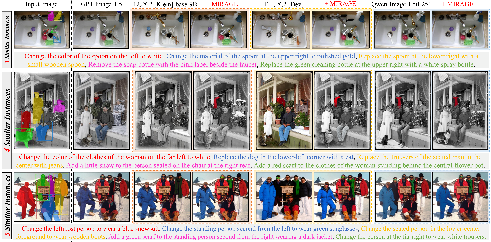
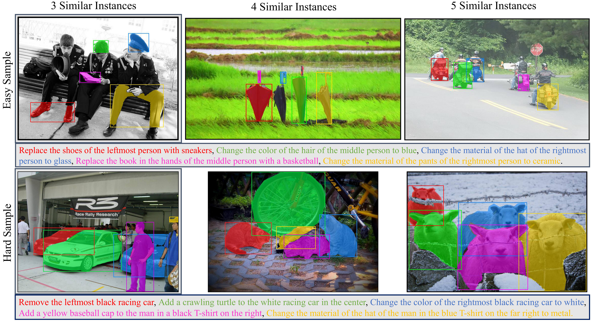

# MIRAGE: Benchmarking and Aligning Multi-Instance Image Editing
[Ziqian Liu](https://scholar.google.com/citations?view_op=list_works&hl=en&user=_1FGL3UAAAAJ) and [Stephan Alaniz](https://scholar.google.com/citations?user=mzZa_yQAAAAJ&hl=en&oi=ao)

[](https://arxiv.org/abs/2604.05180)
[](https://huggingface.co/datasets/ziqiangoodgood/MIRAGE)

> **Abstract:** *Instruction-guided image editing has seen remarkable progress with models like FLUX.2 and Qwen-Image-Edit, yet they still struggle with complex scenarios involving multiple similar instances, each requiring individual edits. We observe that state-of-the-art models suffer from severe over-editing and spatial misalignment when faced with multiple identical instances and composite instructions. To address this, we introduce a comprehensive benchmark specifically designed to evaluate fine-grained consistency in multi-instance and multi-instruction settings. We further propose Multi-Instance Regional Alignment via Guided Editing (MIRAGE), a training-free framework for precise, localized editing. By leveraging a vision-language model to decompose complex instructions into region-specific subsets, MIRAGE employs a multi-branch parallel denoising strategy that injects target-region latents into the global representation while preserving background integrity through a reference trajectory. Extensive evaluations on MIRA-Bench and RefEdit-Bench demonstrate that our framework significantly outperforms existing methods in achieving precise instance-level modifications while maintaining strong background consistency.*


**Fig. 1: Example images and instructions involving multiple similar instances and compositional edits.** Such scenarios are challenging for state-of-the-art models, which often introduce unintended modifications. In contrast, MIRAGE achieves precise instance-level editing while preserving background consistency.

# Benchmark Access
We release **MIRA-Bench**, which can be downloaded on [Huggingface](https://huggingface.co/datasets/ziqiangoodgood/MIRAGE) or [Google Drive](https://drive.google.com/file/d/14uIOvaf7bi4PTc1PRRbbyYRuwbBkPmUc/view?usp=sharing) directly. The benchmark contains 200 samples from real world, each consisting of an image, a composite editing instruction formed by combining five sub-instructions, and the corresponding ground-truth mask. This benchmark is designed to evaluate image editing models in more complex referring-expression scenarios. 


**Fig. 2: MIRA-Bench sample examples.** Easy (top) and hard (bottom) examples containing 3, 4, and 5 similar instances. And the different colors in the instructions correspond to the editing sections in the diagram.


# 1. Requirements
Install the required dependencies:
```bash
conda create -n mirage python=3.12 -y
conda activate mirage
pip install -r requirements.txt
```

Don't forget to log in to your Hugging Face account to get model access:
```bash
echo 'export HF_TOKEN=xxx' >> ~/.bashrc
source ~/.bashrc
```

## Quick Start
To quickly try MIRAGE, you can run the following commands directly. The benchmark will be automatically downloaded from Hugging Face, so no manual setup is required.

```bash
# FLUX.2 [klein]-9B + MIRAGE
python quick_start.py --model flux2_klein9b --output-dir results/flux2_klein9b

# FLUX.2 [dev] + MIRAGE
python quick_start.py --model flux2_dev --output-dir results/flux2_dev

# Qwen-Image-Edit-2511 + MIRAGE
python quick_start.py --model qwen2511 --output-dir results/qwen2511
```

If GPU memory is insufficient, you can enable CPU offloading by adding `--cpu-offload model` or even `--cpu-offload sequential`.
`--patch-ratio` is the fraction of the denoising steps handled by the region branches, i.e. 1 - ρ in the paper. The default of 0.4 is the setting we use on MIRA-Bench; for single-instruction benchmarks such as RefEdit-Bench we use 0.2.

# 2. Inference
We provide MIRAGE integration pipelines for multiple base image editing models.

## 2.1 Target Localization
Before running inference, first decompose the instructions and obtain the cropped regions of the target objects with a VLM. `--vlm` supports `Gemma-4-12B` and `Qwen3.5-9B`:

```bash
python crop_image.py \
  --image-root benchmark \
  --instruction-jsonl benchmark/annotations.jsonl \
  --output-dir benchmark/crops \
  --out-jsonl benchmark/crops/crop_instruction.jsonl \
  --batch-size 2
```

## 2.2 Base model + MIRAGE
Run MIRAGE on a base model, where `--model` is one of `flux2_klein9b`, `flux2_dev` and `qwen2511`:
```bash
python inference.py \
  --model flux2_klein9b \
  --image-root benchmark \
  --instruction-jsonl benchmark/annotations.jsonl \
  --crop-instruction-jsonl benchmark/crops/crop_instruction.jsonl \
  --output-dir results/flux2_klein9b
```

# 3. Evaluation

## LLM-based Metrics
**PF**, **Cons** and **PQ** are all judged by GPT models:
```bash
python metrics/evaluate_gpt.py \
  --annotations-jsonl benchmark/annotations.jsonl \
  --crop-instruction-jsonl benchmark/crops/crop_instruction.jsonl \
  --input-image-root benchmark \
  --edited-image-root results/your_results \
  --result-dir metrics/results/gpt/your_results \
  --mask-alignment-policy full-frame
```

## Traditional Metrics
Compute pixel-level similarity metrics:

```bash
# MSE, LPIPS, PSNR...
python metrics/evaluate_traditional.py \
  --annotations-jsonl benchmark/annotations.jsonl \
  --crop-instruction-jsonl benchmark/crops/crop_instruction.jsonl \
  --input-image-root benchmark \
  --edited-image-root results/your_results \
  --result-csv metrics/results/traditional/metric_summary.csv
```

# Citation
If you use this code or the benchmark in your research, please cite our paper:
```
@misc{liu2026miragebenchmarkingaligningmultiinstance,
      title={MIRAGE: Benchmarking and Aligning Multi-Instance Image Editing}, 
      author={Ziqian Liu and Stephan Alaniz},
      year={2026},
      eprint={2604.05180},
      archivePrefix={arXiv},
      primaryClass={cs.CV},
      url={https://arxiv.org/abs/2604.05180}, 
}
```

# License
This code is released under the [MIT License](LICENSE). The files in `metrics/editscore` are adapted from [EditScore](https://github.com/VectorSpaceLab/EditScore) and remain under the [Apache License 2.0](metrics/editscore/LICENSE).
